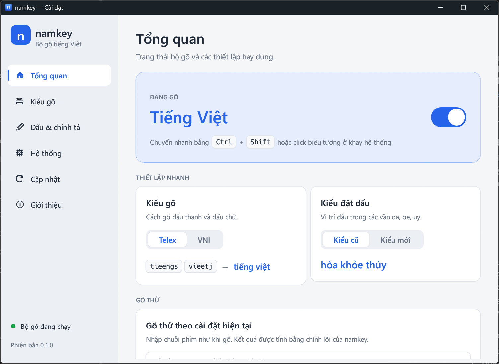
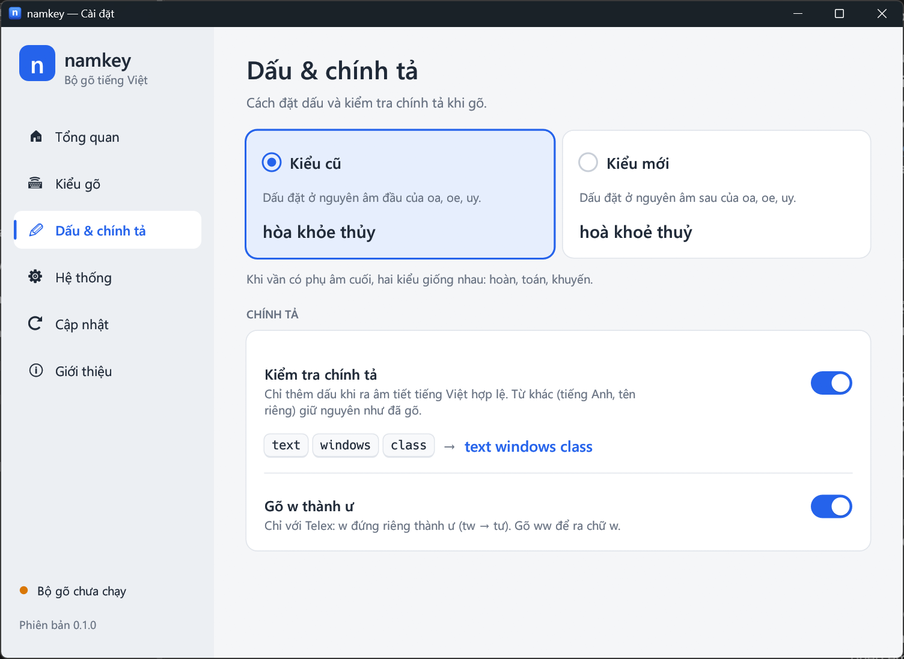

  

<h1 align="center">namkey</h1>

  Bộ gõ tiếng Việt gọn nhẹ, mã nguồn mở, lõi viết bằng Rust. 
  <a href="https://github.com/luu2nam/namkey/releases/latest"><b>⬇ Tải bản mới nhất</b></a>
  &nbsp;·&nbsp;
  <a href="https://namlh.net/namkey">namlh.net/namkey</a>

## Tính năng

- **Telex và VNI.** Gõ dấu ở đâu trong từ cũng được: `toasn` → toán.
- **Đặt dấu kiểu cũ hoặc kiểu mới:** hòa, khỏe, thủy hoặc hoà, khoẻ, thuỷ.
- **Kiểm tra chính tả.** Từ không phải tiếng Việt như `text`, `windows`, `google` được giữ nguyên.
- **Gõ lặp phím để bỏ dấu** (`ass` → as). Xoá lùi không mất dấu (tiếng ⌫ → tiến).
- **Bật/tắt nhanh** bằng **Ctrl+Shift**, hoặc click biểu tượng **V/E** ở khay hệ thống.
- **Cửa sổ cài đặt rõ ràng**, có bảng phím, ví dụ và ô gõ thử.
- **Tự cập nhật** từ trang này, có kiểm tra mã SHA-256 của file tải về.
- **Gọn nhẹ.** Bộ gõ chạy nền chỉ khoảng 300 KB, không quảng cáo, không thu thập dữ liệu.

## Cài đặt (Windows 10/11, 64-bit)

1. Vào trang [Releases](https://github.com/luu2nam/namkey/releases/latest) và tải file `namkey-<phiên bản>-windows-x64.zip`.
2. Giải nén vào một thư mục của bạn, ví dụ `C:\Users\<tên bạn>\namkey`.
   Không nên đặt trong `Program Files`, vì bộ cập nhật cần ghi được vào thư mục này.
3. Chạy **`namkey.exe`**. Biểu tượng **V** sẽ hiện ở khay hệ thống, góc phải thanh tác vụ. Nếu không thấy, bấm mũi tên **^** ở đó.
4. Click phải vào biểu tượng rồi chọn **Cài đặt...** để chọn kiểu gõ và bật **Khởi động cùng Windows**.

> **Lưu ý**
> - namkey chưa được ký số. Lần đầu chạy, Windows SmartScreen có thể cảnh báo: bấm **More info → Run anyway**.
>   Một số phần mềm diệt virus có thể nghi ngờ, vì bộ gõ nào cũng phải đọc phím bấm để thêm dấu.
> - Nếu máy đang có bộ gõ khác (UniKey, EVKey...), hãy tắt nó hoặc chuyển nó sang chế độ tiếng Anh.
>   Nếu không, chữ sẽ bị thêm dấu hai lần và phím Ctrl+Shift bị tranh nhau.

## Sử dụng

| Thao tác | Kết quả |
|---|---|
| **Ctrl+Shift** (bấm rồi thả, không kèm phím khác) | Bật/tắt tiếng Việt |
| Click trái biểu tượng ở khay | Bật/tắt tiếng Việt |
| Click phải biểu tượng ở khay | Chọn Telex/VNI, Cài đặt, Kiểm tra cập nhật, Thoát |

### Bảng phím

| Dấu | Telex | VNI | Ví dụ Telex |
|---|---|---|---|
| Sắc, huyền, hỏi, ngã, nặng | `s` `f` `r` `x` `j` | `1` `2` `3` `4` `5` | `vieetj` → việt |
| Xoá dấu thanh | `z` | `0` | `asz` → a |
| â ê ô | `aa` `ee` `oo` | `6` | `quoocs` → quốc |
| ă | `aw` | `8` | `hoawcj` → hoặc |
| ơ ư | `ow` `uw` (hoặc `w`) | `7` | `nguwowif` → người |
| đ | `dd` | `9` | `dduwowngf` → đường |

## Cập nhật

namkey tự kiểm tra bản mới khi khởi động và mỗi ngày một lần. Khi có bản mới, cửa sổ cập nhật hiện lên,
bấm **Tải về và cập nhật** là xong. Cũng có thể click phải biểu tượng ở khay và chọn **Kiểm tra cập nhật...**.

## Hạn chế đã biết

- Chưa gõ được vào ứng dụng chạy bằng quyền Administrator.
- Thanh địa chỉ của trình duyệt (có gợi ý tự động) đôi khi làm sai chữ.
- Một số từ tiếng Anh trùng với âm tiết tiếng Việt vẫn bị thêm dấu (`this` → thí). Khi gõ tiếng Anh, bấm Ctrl+Shift để tắt.
- Chưa có bản cho macOS và Linux.

Góp ý hoặc báo lỗi: tạo [issue](https://github.com/luu2nam/namkey/issues) tại đây.

## Giấy phép

[MIT](LICENSE) © Lưu Hải Nam · [namlh.net](https://namlh.net)
