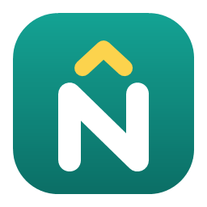
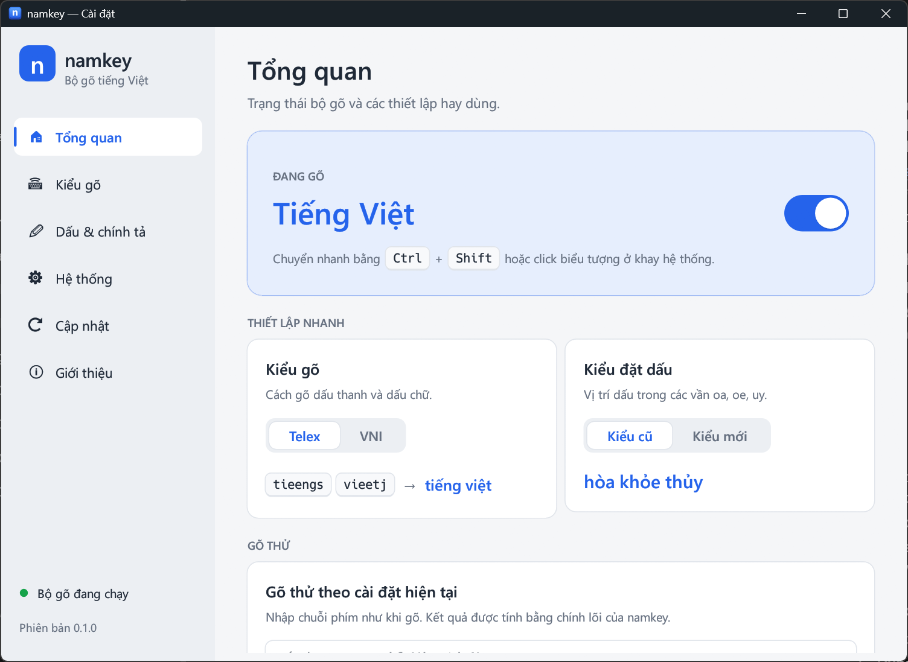
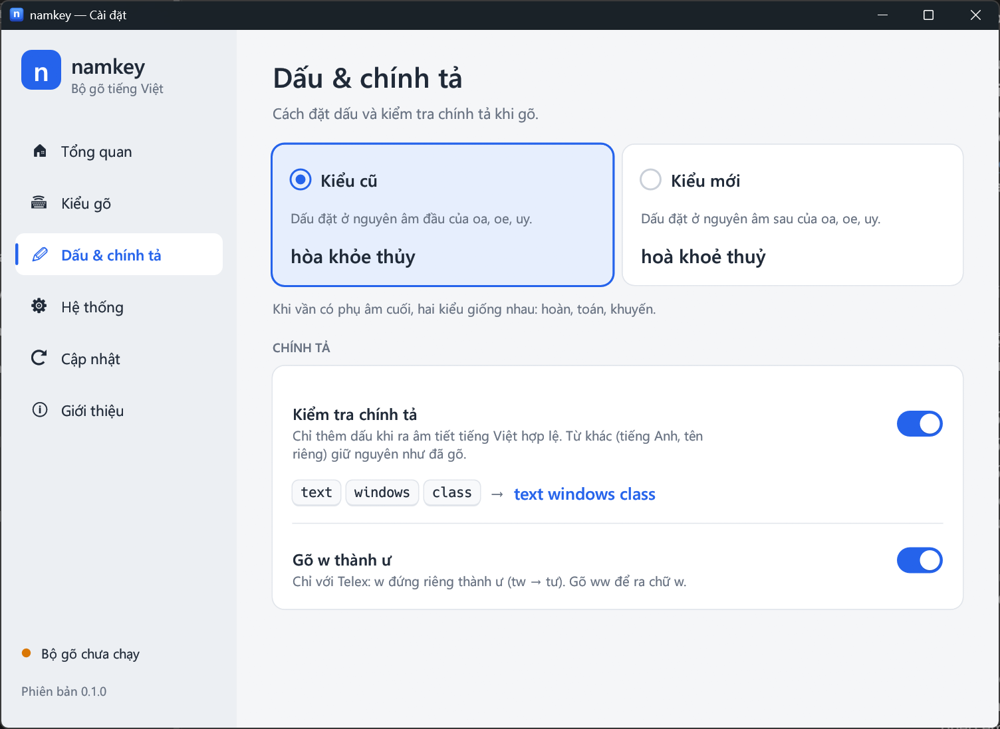

  

<h1 align="center">NamKey</h1>

  Bộ gõ tiếng Việt gọn nhẹ, miễn phí, lõi viết bằng Rust. Có bản cho Windows và macOS. 
  <a href="https://github.com/luu2nam/namkey/releases/latest"><b>⬇ Tải bản mới nhất</b></a>
  &nbsp;·&nbsp;
  <a href="https://namlh.net/namkey">namlh.net/namkey</a>

## Tính năng

- **Telex và VNI, gõ theo thói quen của bạn.** Gõ dấu ở đâu trong từ cũng được, theo thứ tự nào cũng được:
  `nguwowif`, `nguoiwf`, `ngwowif` đều ra **người**; `duongwfd` ra **đường**.
- **Đặt dấu kiểu cũ hoặc kiểu mới:** hòa, khỏe, thủy hoặc hoà, khoẻ, thuỷ.
- **Kiểm tra chính tả với từ điển âm tiết tiếng Việt.** Từ không phải tiếng Việt như `text`, `windows`,
  `google`, `wow`, `data` được giữ nguyên như đã gõ.
- **Gõ lặp phím để bỏ dấu** (`ass` → as). Xoá lùi không mất dấu (tiếng ⌫ → tiến).
- **Gõ tắt:** `vn` + dấu cách → **Việt Nam**; gõ `VN` → **VIỆT NAM**. Nhập, xuất danh sách gõ tắt.
- **Nhớ chế độ Việt/Anh theo từng ứng dụng**, và danh sách ứng dụng **luôn gõ tiếng Anh** (Terminal, game...).
- **Tự tạm ngừng** khi bạn chọn bàn phím chữ khác (Nhật, Trung, Hàn, Nga...); **báo** khi có bộ gõ tiếng Việt
  khác đang chạy.
- **Tuỳ chọn thêm:** `[` `]` gõ ư ơ, Quick Telex (`cc` → ch, `nn` → ng), phụ âm nhanh (`f` → ph), bấm Esc hoặc
  bấm rồi thả Ctrl để trả lại phím của từ đang gõ, giữ nguyên từ tiếng Anh thông dụng, viết hoa chữ đầu câu.
- **Từ tiếng Anh có chữ lặp** (`coffee`, `office`, `pass`) được giữ nguyên, không mất chữ.
- **Chuyển mã văn bản** giữa Unicode, Unicode tổ hợp, TCVN3 (ABC), VNI Windows và CP1258.
- **Gõ ra bảng mã TCVN3 (ABC) hoặc VNI Windows** cho văn bản, bản vẽ dùng font cũ (`.VnTime`, `VNI-Times`),
  chọn chung hoặc riêng cho từng ứng dụng (vd. chỉ AutoCAD gõ TCVN3).
- **Gửi từng phím** cho ứng dụng hay mất chữ, lặp chữ khi thêm dấu (terminal...), chọn riêng từng ứng dụng.
- **Bật/tắt nhanh** bằng **Ctrl+Shift**, hoặc qua biểu tượng **V/E** ở khay hệ thống (Windows) hay thanh menu
  (macOS). **Phím tắt gán lại được**, kể cả để chuyển Telex ↔ VNI hay mở cài đặt.
- **Cửa sổ cài đặt rõ ràng**, có bảng phím, ví dụ và ô gõ thử, giao diện sáng hoặc tối theo hệ thống.
- **Tự cập nhật** từ trang này, có kiểm tra mã SHA-256 của file tải về (Windows; bản macOS báo khi có bản mới).
- **Gọn nhẹ.** Bộ gõ chạy nền chưa tới 1 MB, không quảng cáo, không thu thập dữ liệu.

## Tải về

Vào trang [Releases](https://github.com/luu2nam/namkey/releases/latest) và tải file cho máy của bạn:

| Máy | File |
|---|---|
| Windows 10/11, 64-bit | `namkey-<phiên bản>-windows-x64-setup.exe` |
| macOS 11 trở lên, chip Apple (M1, M2...) | `namkey-<phiên bản>-macos-arm64.zip` |

Các file còn lại trong trang Releases dành cho bộ cập nhật trong app, bạn không cần tải.

## Cài đặt trên Windows

1. Tải file `namkey-<phiên bản>-windows-x64-setup.exe` (xem [Tải về](#tải-về)).
2. Chạy file vừa tải rồi bấm theo hướng dẫn. Không cần quyền quản trị.
3. Biểu tượng **V** sẽ hiện ở khay hệ thống, góc phải thanh tác vụ. Nếu không thấy, bấm mũi tên **^** ở đó.
4. Click phải vào biểu tượng rồi chọn **Cài đặt...** để chọn kiểu gõ.

Muốn dùng không cần cài: tải riêng **`namkey.exe`**, đặt vào một thư mục của bạn rồi chạy. Chỉ cần đúng một file
này, cửa sổ cài đặt đã nằm sẵn bên trong.

Muốn gỡ: vào **Cài đặt Windows → Ứng dụng**, tìm **NamKey** rồi chọn **Gỡ cài đặt**.

> **Lưu ý**
> - NamKey chưa được ký số. Lần đầu chạy, Windows SmartScreen có thể cảnh báo: bấm **More info → Run anyway**.
>   Một số phần mềm diệt virus có thể nghi ngờ, vì bộ gõ nào cũng phải đọc phím bấm để thêm dấu.
> - Nếu máy đang có bộ gõ khác (chẳng hạn UniKey), hãy tắt nó hoặc chuyển nó sang chế độ tiếng Anh.
>   Nếu không, chữ sẽ bị thêm dấu hai lần và phím Ctrl+Shift bị tranh nhau.

## Cài đặt trên macOS

1. Tải file `namkey-<phiên bản>-macos-arm64.zip` (xem [Tải về](#tải-về)), mở file để giải nén ra **NamKey.app**.
2. Kéo **NamKey.app** vào thư mục **Ứng dụng** (Applications), rồi mở nó.
3. Lần đầu mở, macOS sẽ báo không mở được vì NamKey chưa được Apple công chứng. Vào **Cài đặt hệ thống →
   Quyền riêng tư & Bảo mật**, kéo xuống dưới và bấm **Vẫn mở**, rồi mở lại NamKey.
4. NamKey sẽ hướng dẫn cấp quyền **Trợ năng**: bật công tắc cạnh NamKey trong **Cài đặt hệ thống → Quyền riêng
   tư & Bảo mật → Trợ năng**. macOS chỉ cho bộ gõ đọc phím và gửi chữ có dấu khi được cấp quyền này.
5. Biểu tượng **V** hiện trên thanh menu, góc trên bên phải màn hình, là gõ được. Bấm vào biểu tượng rồi chọn
   **Cài đặt...** để chọn kiểu gõ và bật **Khởi động cùng macOS**.

> Trên macOS, phím **Control** đóng vai trò Ctrl. Nếu đang dùng bộ gõ tiếng Việt khác, hãy chuyển nguồn nhập
> về **ABC** để chữ không bị thêm dấu hai lần.

## Sử dụng

| Thao tác | Kết quả |
|---|---|
| **Ctrl+Shift** (bấm rồi thả, không kèm phím khác) | Bật/tắt tiếng Việt |
| Windows: click trái biểu tượng ở khay | Bật/tắt tiếng Việt |
| Windows: nháy đúp biểu tượng ở khay | Mở cửa sổ cài đặt |
| Windows: click phải biểu tượng ở khay | Chọn Telex/VNI, Cài đặt, Kiểm tra cập nhật, Thoát |
| macOS: bấm biểu tượng trên thanh menu | Chọn Tiếng Việt/Tiếng Anh, Telex/VNI, Cài đặt, Kiểm tra cập nhật, Thoát |

### Bảng phím

| Dấu | Telex | VNI | Ví dụ Telex |
|---|---|---|---|
| Sắc, huyền, hỏi, ngã, nặng | `s` `f` `r` `x` `j` | `1` `2` `3` `4` `5` | `vieetj` → việt |
| Xoá dấu thanh | `z` | `0` | `asz` → a |
| â ê ô | `aa` `ee` `oo` | `6` | `quoocs` → quốc |
| ă | `aw` | `8` | `hoawcj` → hoặc |
| ơ ư | `ow` `uw` (hoặc `w`) | `7` | `nguwowif` → người |
| đ | `dd` | `9` | `dduwowngf` → đường |

## Cập nhật

NamKey tự kiểm tra bản mới khi khởi động và mỗi ngày một lần. Cũng có thể chọn **Kiểm tra cập nhật...** trong
menu của biểu tượng V/E.

- **Windows:** khi có bản mới, cửa sổ cập nhật hiện lên, bấm **Tải về và cập nhật** là xong.
- **macOS:** NamKey báo có bản mới và mở trang tải về. Thoát NamKey, tải file zip mới, giải nén rồi thay
  **NamKey.app** cũ trong thư mục Ứng dụng. Quyền Trợ năng vẫn giữ nguyên.

## Hạn chế đã biết

- Windows: chưa gõ được vào ứng dụng chạy bằng quyền Administrator.
- Thanh địa chỉ của trình duyệt (có gợi ý tự động) đôi khi làm sai chữ.
- Từ tiếng Anh trùng với âm tiết tiếng Việt có thật vẫn được gõ thành tiếng Việt (`this` → thí, `six` → sĩ),
  vì đó cũng là cách gõ tiếng Việt hợp lệ. Khi gõ tiếng Anh, bấm Ctrl+Shift để tắt, hoặc bật tuỳ chọn bấm rồi
  thả Ctrl để trả lại phím của một từ.
- macOS: chỉ có bản cho máy chip Apple, chưa được Apple công chứng (notarize), chưa tự cài bản cập nhật.
- Chưa có bản cho Linux.

Góp ý hoặc báo lỗi: gửi ngay trong NamKey (**Cài đặt → Góp ý**, hoặc mục **Góp ý...** trên biểu tượng NamKey),
hoặc tạo [issue](https://github.com/luu2nam/namkey/issues) tại đây.

## Pháp lý

- [Giấy phép sử dụng](LICENSE)
- [Điều khoản sử dụng](legal/DIEU-KHOAN-SU-DUNG.md)
- [Chính sách quyền riêng tư](legal/CHINH-SACH-QUYEN-RIENG-TU.md): NamKey không thu thập, không lưu và không gửi
  đi phím bấm hay dữ liệu cá nhân của bạn.
- [Bản quyền và nhãn hiệu](legal/BAN-QUYEN.md)
- [Thông báo phần mềm bên thứ ba](legal/THONG-BAO-BEN-THU-BA.md) · [toàn văn giấy phép](legal/THIRD-PARTY-LICENSES.txt)

NamKey là phần mềm miễn phí, mã nguồn đóng. © 2026 Lưu Hải Nam, giữ mọi quyền · [namlh.net](https://namlh.net)
